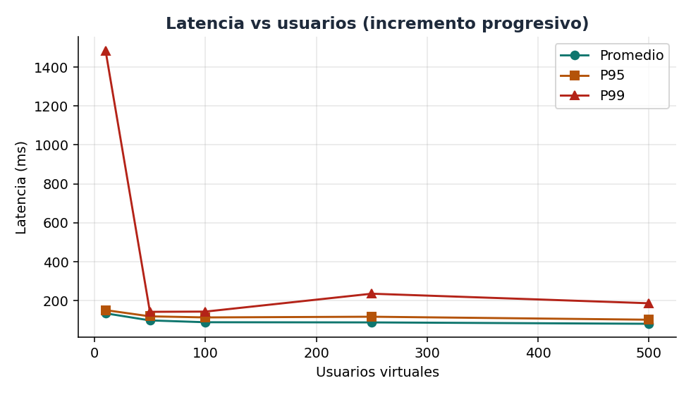
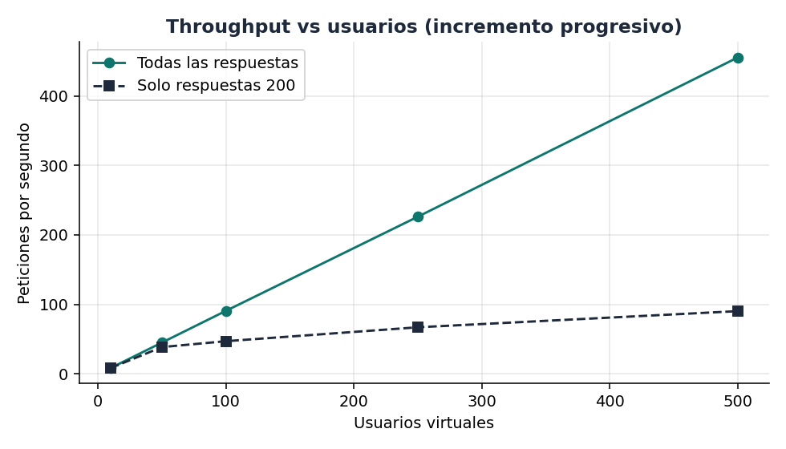
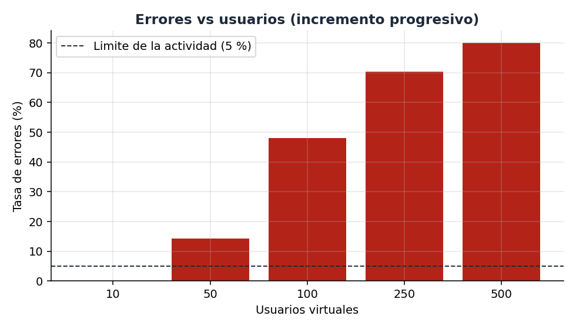
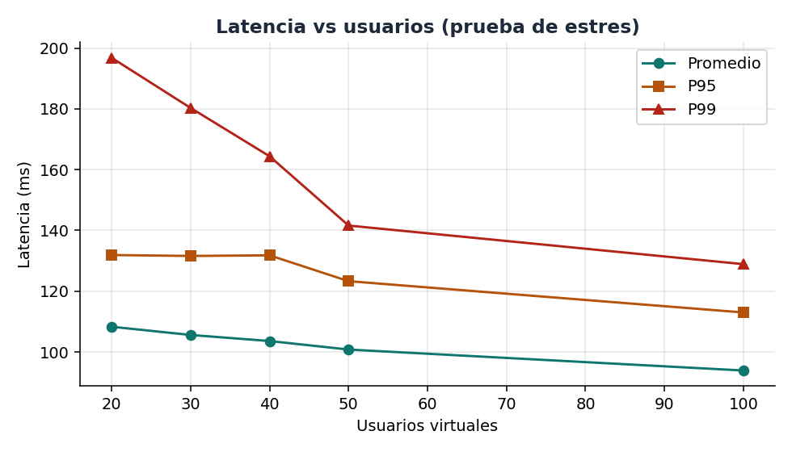
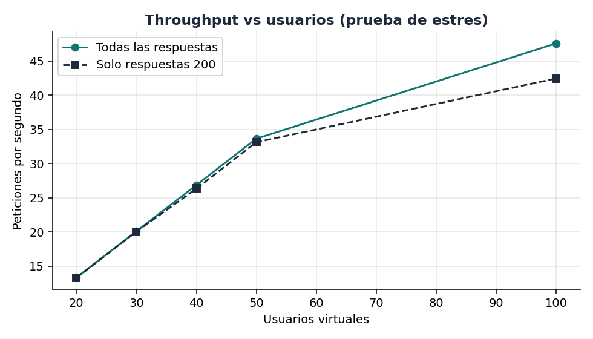
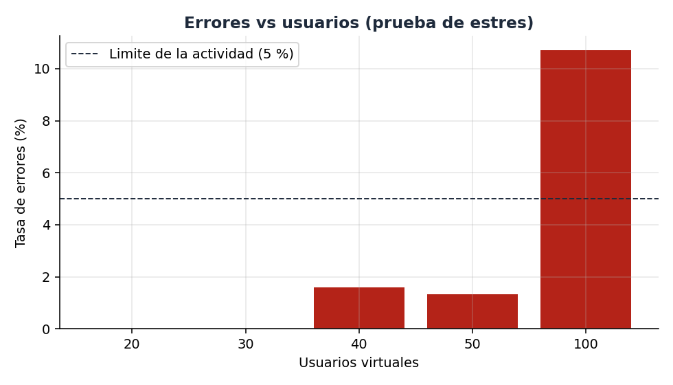
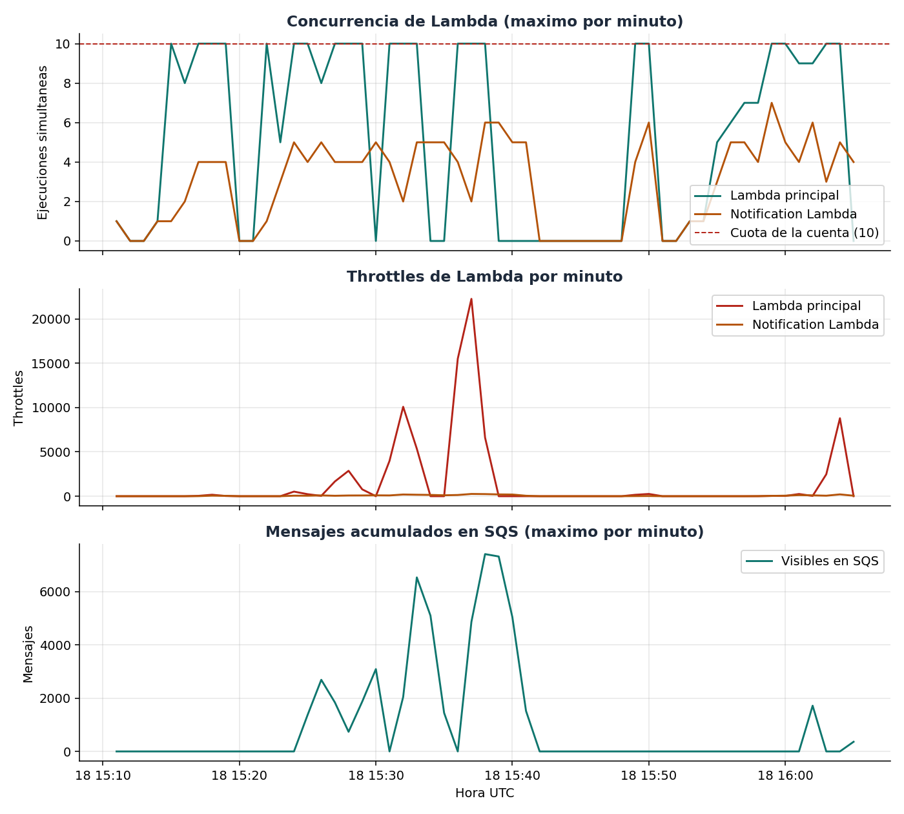
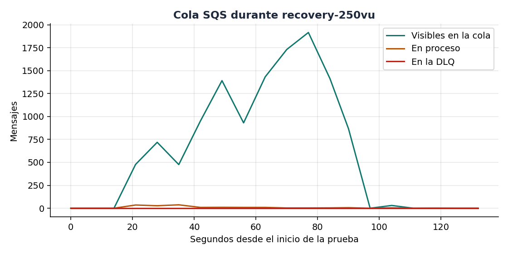

# Informe técnico: pruebas de carga y rendimiento

Todos los números salen de ejecuciones reales guardadas en `load-tests/results/` (K6, logs de CloudWatch y métricas de CloudWatch). No hay valores estimados.

## 1. Arquitectura evaluada

```text
Mobile App
    |
API Gateway (HTTP API)
    |
AWS Lambda principal (Java 17, SnapStart)
    |
SNS
    |
SQS (+ DLQ)
    |
Notification Lambda (Python) ─> SES (correo)
```

La app móvil Flutter llama a `POST /notifications/send` con JWT. La Lambda principal valida y publica en SNS; SNS entrega a SQS; `notification-lambda` consume la cola y envía el correo. Las pruebas apuntan a ese endpoint en la URL real de API Gateway, con el body `{"email": "test@test.com", "subject": "Prueba", "message": "Mensaje de carga"}`.

## 2. Herramienta utilizada

**K6** (v2.3.0, ejecutado en Docker desde el PC del autor). Genera usuarios virtuales (VU) concurrentes contra la API pública y mide latencia, throughput y errores. Los scripts (`baseline.js`, `progressive.js`, `stress.js`, `recovery.js`, `config.js`) y el driver `run.py` están en `load-tests/`; la configuración está documentada en `load-tests/README.md`.

- Cada VU envía una petición, espera 1 s y repite. El login se hace una vez en `setup()` y no cuenta en los resultados.
- Sin secretos en el repositorio: usuario y contraseña de pruebas llegan por variables de entorno (`K6_EMAIL`, `K6_PASSWORD`).
- **Modo de carga:** el destinatario `test@test.com` (dominio `test.com`) hace que `notification-lambda` reciba, valide y registre el mensaje **sin llamar a SES** (sandbox: 200 correos/día). Es el mismo flujo API → Lambda → SNS → SQS → Notification Lambda; solo se omite el envío físico. El envío real se demostró aparte con `leudy0023@hotmail.com` (correo recibido).
- `run.py` muestrea la cola SQS cada 5 s y aplica los criterios de parada.
- Costo: unas 129 541 peticiones medidas, dentro de la capa gratuita o en centavos.

## 3. Escenarios ejecutados

1. **Línea base:** 10 VU, 1 min.
2. **Incremento progresivo:** 50, 100, 250 y 500 VU, 2 min cada uno, cada nivel con la cola vacía.
3. **Estrés:** niveles 20, 30, 40, 50 y 100 VU (rampa de 20 s + 60 s sostenido; solo la fase sostenida cuenta), con parada al superar 5 % de errores, P95 > 5 s, throttling de Lambda o saturación de SQS. Los niveles de 250 y 500 VU se midieron en el escenario progresivo; el estrés se detuvo en 100 VU por superar el 5 % de errores, por lo que no se ejecutaron 750 a 2000.
4. **Recuperación:** 250 VU durante 1 min y detención total; se midió el vaciado de la cola y el regreso de las Lambdas a cero.

Se hicieron dos configuraciones de API Gateway: **como estaba desplegado** (límite 10 req/s, ráfaga 20; se midió primero para tener la línea base real) y con el **límite elevado temporalmente** a 10 000 req/s para medir el resto de la arquitectura. Quedó restaurado a 10/20 al terminar.

Un intento de estrés inicial (20 VU sin rampa, 31,5 % de errores a los 12 s) se descartó porque medía el golpe de arranque simultáneo, no el estado sostenido; se conserva en `results/descartados/`.

## 4. Resultados obtenidos

### Línea base y progresivo

| Usuarios | Duración | Throughput (req/s) | Lat. prom. (ms) | Mín. (ms) | Máx. (ms) | P95 (ms) | P99 (ms) | Error rate | Respuestas |
|---:|---:|---:|---:|---:|---:|---:|---:|---:|---|
| 10 (límite 10/20) | 1 min | 8,7 | 131 | 86 | 1682 | 156 | 1157 | 0 % | 200: 533 |
| 10 (límite alto) | 1 min | 8,4 | 135 | 85 | 1572 | 152 | 1485 | 0 % | 200: 531 |
| 50 (límite 10/20) | 2 min | 45,8 | 79 | 58 | 841 | 114 | 133 | 81,9 % | 200: 1010 · 429: 4338 · 5xx: 231 |
| 50 | 2 min | 45,0 | 99 | 64 | 512 | 120 | 143 | 14,3 % | 200: 4694 · 5xx: 782 |
| 100 | 2 min | 90,6 | 90 | 59 | 507 | 114 | 144 | 48,0 % | 200: 5731 · 5xx: 5300 |
| 250 | 2 min | 226,2 | 89 | 59 | 933 | 118 | 236 | 70,4 % | 200: 8174 · 5xx: 19416 |
| 500 | 2 min | 455,5 | 82 | 58 | 1474 | 102 | 187 | 80,1 % | 200: 11009 · 5xx: 44361 |

El throughput es el total de peticiones por segundo de K6 (incluye rechazos). La latencia es la de la petición de punta a punta (incluye rechazos rápidos).

### Estrés (fase sostenida)

| Usuarios | Throughput (req/s) | Lat. prom. (ms) | Mín. (ms) | Máx. (ms) | P95 (ms) | P99 (ms) | Error rate | Resultado |
|---:|---:|---:|---:|---:|---:|---:|---:|---|
| 20 | 13,4 | 108 | 83 | 553 | 132 | 197 | 0 % | sin throttling |
| 30 | 20,1 | 106 | 80 | 333 | 132 | 180 | 0 % | sin throttling |
| 40 | 26,9 | 104 | 69 | 831 | 132 | 164 | 1,6 % | primer throttling de Lambda |
| 50 | 33,7 | 101 | 63 | 494 | 123 | 142 | 1,3 % | throttling, bajo 5 % |
| 100 | 47,6 | 94 | 60 | 168 | 113 | 129 | 10,7 % | **detenido: > 5 % de errores** |

### Recuperación (250 VU, 1 min)

13 749 peticiones, 81,9 % de errores, latencia prom. 88 ms. La cola llegó a 1917 mensajes visibles en el muestreo de K6, 0 en la DLQ, y se **vació en 68 s** tras detener la carga.

## 5. Gráficas de rendimiento

Construidas solo con los resultados reales (`python load-tests/plot.py`).










La latencia se mantiene plana (~80-140 ms) mientras los errores crecen: lo que sobra se rechaza al instante.

## 6. Monitoreo AWS (CloudWatch)

Métricas por minuto de todo el período de pruebas (`results/aws-metrics-todo.csv`, `python run.py metrics`). Totales:

| Métrica | Total |
|---|---:|
| API Gateway Count (Request Count) | 132 548 |
| API Gateway 4xx | 4338 |
| API Gateway 5xx | 82 111 |
| Lambda principal: Invocations | 46 099 |
| Lambda principal: Errors | 0 |
| Lambda principal: Throttles | 82 111 |
| SNS NumberOfMessagesPublished | 46 079 |
| SQS NumberOfMessagesSent | 46 079 |
| Notification Lambda: Invocations | 46 079 |
| Notification Lambda: Errors | 0 |
| Notification Lambda: Throttles | 3067 |

Latencia de API Gateway: promedio por minuto de 7 a 1290 ms (media 106 ms); IntegrationLatency prácticamente igual (8 a 1286 ms, media 106 ms). Duration por minuto: Lambda principal 17 a 624 ms (media 67 ms); Notification Lambda 2 a 1525 ms (media 40 ms). `ConcurrentExecutions` de ambas Lambdas y `ApproximateNumberOfMessagesVisible` están en la gráfica y en el extracto por minuto de la sección 8.

La diferencia entre el Count de API Gateway (132 548) y las peticiones medidas por K6 (129 541) son los logins de `setup()` y las pruebas de humo. Las 20 invocaciones de más de la Lambda principal (46 099 frente a 46 079 publicaciones) corresponden a esos mismos logins.

## 7. Qué muestran los logs (CloudWatch Logs Insights)

Resultados en `results/logs-*.json`:

- **Cero errores y cero excepciones** dentro de las Lambdas en todas las pruebas.
- Cada 5xx de K6 **no tiene ejecución** de la Lambda principal: el rechazo ocurre antes del código. La Lambda dura ~20 ms de promedio por ejecución.
- `notification-lambda` tarda ~3 ms por mensaje en modo de carga, con pocos arranques en frío (5 en recuperación) y sin fallos de procesamiento.
- Con 250 VU el consumidor va por detrás del productor; la cola se drena después sin pérdida.
- Las ejecuciones lentas (P99 de la línea base: 1,1 a 1,5 s) corresponden a las primeras peticiones tras un periodo de inactividad, no a un patrón sostenido.

## 8. Cuello de botella identificado

1. **Primero, API Gateway con límite 10 req/s / ráfaga 20** (config. original): con 50 VU devolvió **429** en 78 % de las peticiones. Medido y confirmado por el código de estado.
2. **Con el límite elevado, la concurrencia de Lambda de la cuenta (cuota de 10 ejecuciones simultáneas).** Confirmado con métricas de CloudWatch (`results/aws-metrics-todo.csv`, `python run.py metrics`):
   - `Throttles` de la Lambda principal **= `5xx` de API Gateway**, minuto a minuto (p. ej. 15:37 UTC: 22 253 vs 22 251; 15:36: 15 500 vs 15 500). Los 503 son rechazos por throttling de Lambda.
   - `ConcurrentExecutions` de la Lambda principal llega a **10 y se queda en 10** en cada minuto con carga alta (cuota de la cuenta).
   - `notification-lambda`, consumidora de SQS, también sufre throttling (hasta 254 por minuto, 15:37) y compite por el mismo cupo. SQS reintenta esos mensajes: por eso la cola crece (hasta 7408 visibles a las 15:38) y se vacía sola después.
   - `Errors` de ambas Lambdas = 0: el fallo es de capacidad, no de código.
   - Estrés: sin throttling hasta 30 VU (15:55–15:57); aparece en 40 VU (15:58–15:59, 1 y 34) y crece con 50 y 100 VU.

   Extracto por minuto (UTC, 18-oct-2026):

   | Minuto | Prueba | GW Count | GW 4xx | GW 5xx | Throttles (principal) | Conc. máx. (principal) | Throttles (consumidora) | SQS visibles máx. |
   |---|---|---|---|---|---|---|---|---|
   | 15:18 | 50 VU, límite 10/20 | 2798 | 2207 | 165 | 165 | 10 | 63 | 0 |
   | 15:25 | 50 VU | 2715 | 0 | 228 | 228 | 10 | 55 | 1372 |
   | 15:32 | 250 VU | 13793 | 0 | 10080 | 10080 | 10 | 192 | 2043 |
   | 15:37 | 500 VU | 27811 | 0 | 22253 | 22251 | 10 | 254 | 4865 |
   | 15:56 | estrés 30 VU | 893 | 0 | 0 | 0 | 6 | 0 | 0 |
   | 16:00 | estrés 50 VU | 2708 | 0 | 32 | 32 | 10 | 59 | 0 |
   | 16:04 | recuperación 250 VU | 10749 | 0 | 8789 | 8789 | 10 | 205 | 0 |

No se identificó a SNS, SQS ni SES como limitantes: SNS publicó 46 079 mensajes, SQS recibió 46 079 y `notification-lambda` ejecutó 46 079 (ninguno perdido, DLQ en 0); SES no entró en las pruebas de carga.

**Conclusión:** el primer componente que limitó el rendimiento fue **API Gateway por su límite configurado de 10 req/s (429)** y, una vez elevado, **la concurrencia de Lambda de la cuenta (10)**, compartida entre la Lambda principal y la Notification Lambda.

## 9. Prueba de recuperación

Con 250 VU durante 1 min (16:03:45 a 16:04:47 UTC) hubo 8789 throttles de la Lambda principal en el minuto pico (16:04). Al detener la carga:

- **SQS:** 362 mensajes visibles a las 16:05; el muestreo de K6 midió el vaciado completo en **68 s**; DLQ en 0.
- **Lambdas:** la Notification Lambda terminó de drenar (1520 invocaciones a las 16:05, con 54 throttles que SQS reintentó); desde las 16:06 ambas Lambdas están en cero invocaciones, concurrencia 0 y throttles 0.
- **Sistema:** volvió a estado normal sin intervención manual, en unos 2 minutos tras detener la carga.

## 10. Recomendaciones de mejora (ligadas a lo medido)

1. **Aumentar la cuota de concurrencia de Lambda de la cuenta** (Service Quotas, de 10 a un valor típico, p. ej. 1000). Es la causa de los 82 111 throttles y del tope de ~34 req/s sin errores. Mayor efecto.
2. **Limitar la concurrencia del consumidor SQS** (*maximum concurrency* del event source mapping) para que `notification-lambda` no consuma el cupo de la Lambda principal: se midieron 3067 throttles en ella.
3. **Subir el límite de API Gateway** acorde al tráfico esperado; con 10/20 ya rechazaba el 78 % de las peticiones con 50 VU.
4. **Reintentos con espera exponencial y `Retry-After`** en el cliente móvil ante 503: los rechazos son rápidos (~100 ms) y recuperables.
5. **Solicitar salida del sandbox de SES** antes de enviar correos reales a gran volumen (200/día, 1/s).
6. Tras cada cambio, repetir la línea base y comparar con estos resultados.

## 11. Preguntas de análisis

- **¿Máximo de usuarios concurrentes soportados?** Dentro de los límites de la actividad (errores < 5 %, latencia < 5 s): **50 VU (~34 req/s)**. Sin ningún throttling de Lambda: **30 VU (~20 req/s)**; el primer throttling apareció con 40 VU. Con 100 VU se superó el 5 % de errores y se detuvo la prueba.
- **¿Tiempo de respuesta promedio?** Línea base 131 ms (mín. 86, máx. 1682). En el resto de escenarios, de 79 a 135 ms de promedio y P95 entre 102 y 156 ms.
- **¿Throttling en alguna Lambda?** **Sí, en las dos.** Lambda principal 82 111 throttles (= los 5xx de API Gateway); Notification Lambda 3067 (SQS reintentó esos mensajes). Errors = 0.
- **¿SNS perdió mensajes?** No. Publicados 46 079 = SQS Sent 46 079 = invocaciones de la Notification Lambda 46 079; DLQ en 0.
- **¿SQS absorbió los picos?** Sí. Llegó a 7408 mensajes visibles (500 VU) y se vació después sin pérdida ni DLQ; en la recuperación se vació en 68 s.
- **¿Cuál componente fue el cuello de botella?** La concurrencia de Lambda de la cuenta (cuota de 10) y, antes, el límite de API Gateway (10 req/s). Ver sección 8.
- **¿Qué cambios para soportar el doble de tráfico?** El doble de 50 VU son 100 VU (~68 req/s): subir la cuota de concurrencia de Lambda (la de 10 ya está saturada con ~34 req/s), limitar la concurrencia del consumidor SQS y subir el límite de API Gateway por encima de la tasa esperada. Después, repetir la línea base y el estrés.

### Resultado esperado de la actividad

1. Carga soportada: 50 VU (30 sin throttling). 2. Latencia plana (~80-140 ms). 3. Throughput sostenible ~34 req/s con 50 VU; el total de K6 crece con los VU porque se rechaza rápido. 4. Errores desde 40 VU. 5. Sí hay throttling en Lambda. 6. SNS sin pérdidas. 7. SQS absorbe y drena. 8. La Notification Lambda procesó todo (con reintentos tras throttling). 9. Degradación entre 40 y 100 VU. 10. Recuperación en ~2 min. 11. Cuello: concurrencia de Lambda. 12. Mejoras: sección 10.

## 12. Limitaciones y evidencias pendientes

- K6 corre desde un PC doméstico; las métricas de CloudWatch tienen resolución de 1 minuto.
- Las capturas de pantalla de la consola AWS (API Gateway, Lambda, SNS, SQS, CloudWatch Logs) las toma el autor; los datos equivalentes están en `results/aws-metrics-todo.csv` y en las gráficas. Ventanas reales del 2026-10-18 (inicio a fin de K6):

- 15:15:58–15:16:59 UTC: baseline-como-desplegado
- 15:17:50–15:19:52 UTC: progressive-50vu-como-desplegado
- 15:22:55–15:23:58 UTC: baseline-limite-alto
- 15:24:21–15:26:23 UTC: progressive-50vu
- 15:27:34–15:29:35 UTC: progressive-100vu
- 15:31:35–15:33:37 UTC: progressive-250vu
- 15:36:17–15:38:18 UTC: progressive-500vu
- 15:54:55–15:56:16 UTC: stress-20vu
- 15:56:26–15:57:48 UTC: stress-30vu
- 15:58:04–15:59:26 UTC: stress-40vu
- 15:59:42–16:01:04 UTC: stress-50vu
- 16:01:20–16:02:02 UTC: stress-100vu
- 16:03:45–16:04:47 UTC: recovery-250vu
